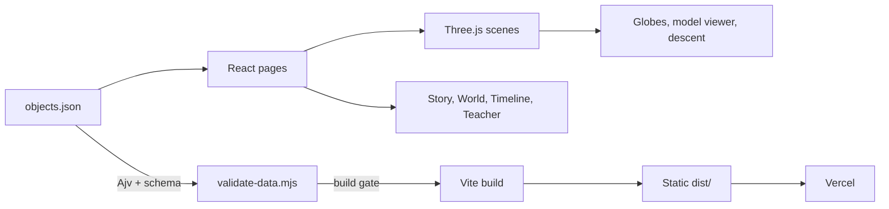

<div align="center">

# Abandoned but Not Forgotten

**They stopped moving. Their stories didn't.**

A scroll-driven, 3D storytelling experience for the **NASA Space Apps Challenge 2026**.<br />
Students aged 10–15 meet six pieces of NASA hardware left on the Moon and Mars, learn the science each one made possible, and finish every story by answering the question it left behind.

<br />


[Features](#features) · [The collection](#the-collection) · [Quick start](#quick-start) · [Architecture](#architecture) · [Data integrity](#data-integrity) · [Accessibility](#accessibility-and-privacy) · [Roadmap](#roadmap)

</div>

<br />

## Overview

Every object in this project was built to do one job, and then it was left behind. Each story follows the same five-chapter arc, from first sight to the open question the machine left unanswered, so a young reader moves from curiosity to understanding to their own hypothesis.

| | |
|---|---|
| **Audience** | Students aged 10–15, and the teachers who guide them |
| **Format** | Static single-page site with scroll-driven 3D scenes |
| **Content** | Six objects on the Moon and Mars, plus a Voyager 1 epilogue |
| **Sourcing** | Every record links to `nasa.gov`, and is checked at build time |
| **Privacy** | No backend, no accounts, no tracking |

## The collection

| Object | Place | Year |
|---|---|---|
| Apollo 11 Laser Ranging Retroreflector | Moon | 1969 |
| Apollo Lunar Roving Vehicle | Moon | 1971 |
| Surveyor 3 | Moon | 1967 |
| Sojourner Rover (Mars Pathfinder) | Mars | 1997 |
| Opportunity Rover | Mars | 2004 |
| InSight Lander | Mars | 2018 |
| *Epilogue:* Voyager 1 | Beyond the Moon and Mars | 1977 |

## Features

**Storytelling**
- **Five-chapter stories.** Each object's story is driven by a single JSON record, so content and layout stay separate.
- **Confirmed, Scientists think, Still unknown.** Every story separates established fact from inference and from open questions.
- **"Your next mission."** Students answer the question the object left behind and get feedback on each option.
- **Sources on every object.** A "Where this comes from" panel links back to NASA.

**Immersive 3D**
- **Interactive viewer.** Rotate and zoom each object, with hotspots on three parts per model.
- **Scroll-driven scenes.** The landing page flies from the Moon to Mars on real NASA globes, with each object pinned at its true coordinates. Chapter 4 descends from orbit to the exact landing site.
- **Graceful fallback.** Browsers without WebGL get NASA photographs instead.

**Exploration and teaching**
- **Timeline and map.** A 1967–2022 timeline, plus a Moon and Mars map placing each object at its real latitude and longitude.
- **Question Constellation.** Students collect their own questions, stored in `localStorage` only.
- **Printable teacher page.** Available at `#/teacher`, with print styles included.

<details>
<summary><strong>Requirement traceability (PRD v2.0)</strong></summary>

<br />

| ID | Requirement | Where |
|---|---|---|
| FR-01 | Landing page, tagline, Moon/Mars choice | `src/pages/Home.tsx` |
| FR-02 | Five-chapter story driven by one JSON file | `src/pages/Story.tsx`, `src/data/objects.json` |
| FR-03 | 3D viewer (rotate, zoom) with image fallback | `src/components/Viewer.tsx`, `src/three/` |
| FR-04 | Fact panel | `FactPanel` in `src/components/bits.tsx` |
| FR-05 | Confirmed / Scientists think / Still unknown | Chapter 5 in `Story.tsx` |
| FR-06 | "Your next mission" choice with feedback per option | Chapter 5 in `Story.tsx` |
| FR-07 | "Where this comes from" source panel | `SourcePanel` in `bits.tsx` |
| FR-08 | Mobile-friendly layout | `src/styles.css` (tested at 375 px wide) |
| FR-09 | 3D hotspots on 3 parts per model | `hotspots[]` in the JSON |
| FR-10 | Timeline 1967–2022 | `src/pages/Timeline.tsx` |
| FR-11 | Keyboard nav, alt text, reduced motion | Hotspots mirrored as real buttons; `prefers-reduced-motion` stops auto-rotate, twinkle and animations |
| FR-12 | Question Constellation (localStorage only) | `src/pages/Constellation.tsx` |
| FR-13 | Printable teacher page | `src/pages/Teacher.tsx` |
| FR-14 | Voyager 1 epilogue | Flagged `epilogue: true` in the JSON |

</details>

## Quick start

**Prerequisites:** Node.js 18 or later and npm.

```bash
git clone https://github.com/Perfectreviewer/abandoned-but-not-forgotten.git
cd abandoned-but-not-forgotten
npm install
npm run dev
```

The dev server runs at <http://localhost:5173>.

| Command | Description |
|---|---|
| `npm run dev` | Start the Vite dev server |
| `npm run build` | Validate data, type-check, and build to `dist/` |
| `npm run preview` | Serve the production build locally |
| `npm run validate` | Validate `src/data/objects.json` against the schema |
| `npm run validate:strict` | Same, and fail while any fact-check is still `PENDING`. Run before submitting. |

## Architecture



```
.
├── public/
│   ├── models/          Compressed NASA glTF models
│   └── textures/        Moon and Mars globe textures
├── scripts/             Data validation and model tooling
├── src/
│   ├── components/      Shared UI, viewer, starfield, effects
│   ├── data/            objects.json and its TypeScript types
│   ├── lib/             GSAP, motion and utility helpers
│   ├── pages/           Home, Story, World, Timeline, Constellation, Teacher, About
│   └── three/           Globes, scenes, model viewer and hand-built models
└── index.html
```

### Tech stack

| Layer | Tools |
|---|---|
| Framework | React 18, TypeScript, Vite |
| 3D | Three.js via React Three Fiber, Drei and postprocessing, lazy-loaded after first paint |
| Motion | GSAP with ScrollTrigger, Framer Motion, Lenis smooth scrolling |
| Validation | Ajv with JSON Schema |
| Storage | `localStorage` only |
| Hosting | Vercel |

## Data integrity

All story content lives in `src/data/objects.json`. `scripts/validate-data.mjs` checks it against `scripts/object.schema.json`, and **the build fails** if a record:

- is missing `sources` (which must be `nasa.gov` URLs) or `verifiedBy`;
- has a mission text over 80 words;
- has the same writer and checker;
- sits outside the Moon or Mars without being marked as the epilogue;
- uses images not hosted by the NASA Image and Video Library.

Each object shows a "Draft" badge until a named checker and date are recorded in `verifiedBy`.

## Accessibility and privacy

- Full keyboard navigation, with 3D hotspots mirrored as real buttons.
- Alt text on images.
- `prefers-reduced-motion` disables auto-rotate, twinkle and other animations.
- Mobile-friendly layout, tested at 375 px wide.
- No analytics or tracking. The only stored data is the student's own constellation, kept in their browser.

## Deployment

The build is fully static and deployed on **Vercel**. Import the repository and choose the **Vite** framework preset. Vercel builds with `npm run build` and serves `dist/`.

## Roadmap

- [ ] Fact-check every object against its linked NASA sources, then record `verifiedBy.checker` and `verifiedBy.date`. **Blocking for submission.**
- [ ] Replace the hand-built models (retroreflector, Lunar Rover, Surveyor 3, Sojourner) with better ones, if available. NASA publishes none for these.
- [ ] Re-check the 2026 submission guide when it is released on 13 November.
- [ ] Record the 30-second demo with English subtitles.

<details>
<summary><strong>Adding or replacing a 3D model</strong></summary>

<br />

Compress the model, then register it in the JSON:

```bash
npx gltf-transform optimize in.glb public/models/<id>.glb --compress meshopt --texture-compress false
```

Set `"modelPath"` for the object, then place hotspots using `?debug`: open `http://localhost:5173/?debug#/object/<id>` and click the model to print coordinates to the console. `scripts/model-geometry.mjs` is also available.

</details>

## AI use

AI tools (Claude) helped write the code and draft the story text. Every AI-drafted fact must be checked against a NASA source by a teammate before it is marked verified.

## Credits

All imagery and 3D models come from NASA, including the NASA Image and Video Library and NASA 3D Resources. See the in-app About page for full credits. This project is not affiliated with or endorsed by NASA.

<div align="center">

<br />

*Built for the NASA Space Apps Challenge 2026.*

</div>
